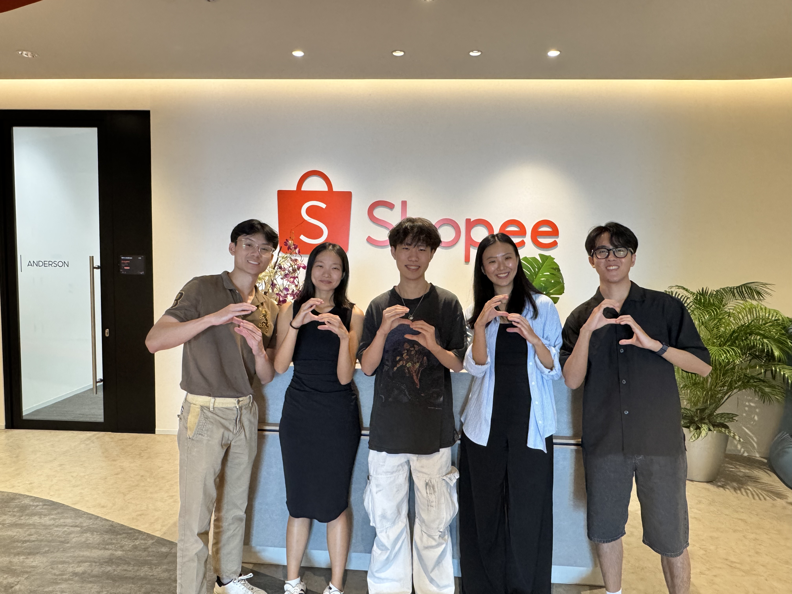

<!-- Animated typing header. Edit the text after "lines=" (use + for spaces, ; to add a second line) -->

  
  &nbsp;
  <a href="xinyikiki@gmail.com" aria-label="Email me">
    

## About Me

  
  &nbsp;&nbsp;&nbsp;
  
  &nbsp;&nbsp;&nbsp;
  

  Hi! I'm <strong>Xinyi (Kiana)</strong>, a <strong>Y3 Renaissance Engineering Program</strong> student at
  <strong>Nanyang Technological University</strong>. I enjoy tackling business problems through quantitative
  data lenses.
  
  Outside of work, you'll find me <strong>travelling</strong>
  or hunting for the best <strong>MALA</strong> in town.

<ul>
  <li>🎓 Currently Studying: <strong>EECS @ UC Berkeley for my year abroad :) </strong> (Graduating <strong>Dec 2028</strong>)</li>
  <li>🌱 Currently Dabbling: <strong> Workflow Automation with AI Agents, webscraping and Power Automate </strong></li>
</ul>

## Past Projects

<table>
  <tr>
    <td width="50%" valign="top">
      
<a href="https://github.com/xingupyi/Taobao-User-Behaviour-Analysis"><strong>Project One</strong></a>

      
Funnel analysis on Taobao user behaviour using SQL.

    </td>
    <td width="50%" valign="top">
      
<a href="https://github.com/xingupyi/Plant-Co.-PowerBI-Project"><strong>Project Two</strong></a>

      
Designing of data schema and visualisation in PowerBI.

    </td>
  </tr>
  <tr>
    <td width="50%" valign="top">
      
<a href="https://github.com/xingupyi/SG-Graduate-Employment-Dashboard"><strong>Project Three</strong></a>

      
One sentence on what it does and why it matters.

    </td>
    <td width="50%" valign="top">
      
<a href="https://github.com/YOU/PROJECT-4"><strong>Project Four</strong></a>

      
One sentence on what it does and why it matters.

    </td>
  </tr>
</table>

## Skills

<!-- Full icon list: https://github.com/tandpfun/skill-icons#icons-list -->

### Languages

  

### Libraries

  

### Tools

  

## 🗳️ Quick Polls

<!-- POLLS:START -->
<table>
<tr><th align="left">Question</th><th>Vote</th><th align="left">Results</th></tr>
<tr><td>🌿 Do you like coriander?</td><td align="center"><a href="https://github.com/xingupyi/xingupyi/issues/new?title=%5BVote%5D%20coriander%20yes&body=Just%20click%20%2A%2ACreate%2A%2A%20/%20%2A%2ASubmit%20new%20issue%2A%2A%20below%20to%20cast%20your%20vote%21%20%F0%9F%97%B3%EF%B8%8F%0A%0A_Changed%20your%20mind%3F%20Vote%20again%20any%20time%20and%20your%20latest%20vote%20counts._">👍 Yes</a> &nbsp; <a href="https://github.com/xingupyi/xingupyi/issues/new?title=%5BVote%5D%20coriander%20no&body=Just%20click%20%2A%2ACreate%2A%2A%20/%20%2A%2ASubmit%20new%20issue%2A%2A%20below%20to%20cast%20your%20vote%21%20%F0%9F%97%B3%EF%B8%8F%0A%0A_Changed%20your%20mind%3F%20Vote%20again%20any%20time%20and%20your%20latest%20vote%20counts._">👎 No</a></td><td><code>░░░░░░░░░░</code> no votes yet 👍 0 · 👎 0</td></tr>
<tr><td>🍍 Pineapple on pizza?</td><td align="center"><a href="https://github.com/xingupyi/xingupyi/issues/new?title=%5BVote%5D%20pineapple-pizza%20yes&body=Just%20click%20%2A%2ACreate%2A%2A%20/%20%2A%2ASubmit%20new%20issue%2A%2A%20below%20to%20cast%20your%20vote%21%20%F0%9F%97%B3%EF%B8%8F%0A%0A_Changed%20your%20mind%3F%20Vote%20again%20any%20time%20and%20your%20latest%20vote%20counts._">👍 Yes</a> &nbsp; <a href="https://github.com/xingupyi/xingupyi/issues/new?title=%5BVote%5D%20pineapple-pizza%20no&body=Just%20click%20%2A%2ACreate%2A%2A%20/%20%2A%2ASubmit%20new%20issue%2A%2A%20below%20to%20cast%20your%20vote%21%20%F0%9F%97%B3%EF%B8%8F%0A%0A_Changed%20your%20mind%3F%20Vote%20again%20any%20time%20and%20your%20latest%20vote%20counts._">👎 No</a></td><td><code>░░░░░░░░░░</code> no votes yet 👍 0 · 👎 0</td></tr>
<tr><td>🐱 Are cats better than dogs?</td><td align="center"><a href="https://github.com/xingupyi/xingupyi/issues/new?title=%5BVote%5D%20cats-vs-dogs%20yes&body=Just%20click%20%2A%2ACreate%2A%2A%20/%20%2A%2ASubmit%20new%20issue%2A%2A%20below%20to%20cast%20your%20vote%21%20%F0%9F%97%B3%EF%B8%8F%0A%0A_Changed%20your%20mind%3F%20Vote%20again%20any%20time%20and%20your%20latest%20vote%20counts._">👍 Yes</a> &nbsp; <a href="https://github.com/xingupyi/xingupyi/issues/new?title=%5BVote%5D%20cats-vs-dogs%20no&body=Just%20click%20%2A%2ACreate%2A%2A%20/%20%2A%2ASubmit%20new%20issue%2A%2A%20below%20to%20cast%20your%20vote%21%20%F0%9F%97%B3%EF%B8%8F%0A%0A_Changed%20your%20mind%3F%20Vote%20again%20any%20time%20and%20your%20latest%20vote%20counts._">👎 No</a></td><td><code>░░░░░░░░░░</code> no votes yet 👍 0 · 👎 0</td></tr>
<tr><td>🌭 Is a hot dog a sandwich?</td><td align="center"><a href="https://github.com/xingupyi/xingupyi/issues/new?title=%5BVote%5D%20hotdog-sandwich%20yes&body=Just%20click%20%2A%2ACreate%2A%2A%20/%20%2A%2ASubmit%20new%20issue%2A%2A%20below%20to%20cast%20your%20vote%21%20%F0%9F%97%B3%EF%B8%8F%0A%0A_Changed%20your%20mind%3F%20Vote%20again%20any%20time%20and%20your%20latest%20vote%20counts._">👍 Yes</a> &nbsp; <a href="https://github.com/xingupyi/xingupyi/issues/new?title=%5BVote%5D%20hotdog-sandwich%20no&body=Just%20click%20%2A%2ACreate%2A%2A%20/%20%2A%2ASubmit%20new%20issue%2A%2A%20below%20to%20cast%20your%20vote%21%20%F0%9F%97%B3%EF%B8%8F%0A%0A_Changed%20your%20mind%3F%20Vote%20again%20any%20time%20and%20your%20latest%20vote%20counts._">👎 No</a></td><td><code>░░░░░░░░░░</code> no votes yet 👍 0 · 👎 0</td></tr>
<tr><td>⌨️ Tabs over spaces?</td><td align="center"><a href="https://github.com/xingupyi/xingupyi/issues/new?title=%5BVote%5D%20tabs-spaces%20yes&body=Just%20click%20%2A%2ACreate%2A%2A%20/%20%2A%2ASubmit%20new%20issue%2A%2A%20below%20to%20cast%20your%20vote%21%20%F0%9F%97%B3%EF%B8%8F%0A%0A_Changed%20your%20mind%3F%20Vote%20again%20any%20time%20and%20your%20latest%20vote%20counts._">👍 Yes</a> &nbsp; <a href="https://github.com/xingupyi/xingupyi/issues/new?title=%5BVote%5D%20tabs-spaces%20no&body=Just%20click%20%2A%2ACreate%2A%2A%20/%20%2A%2ASubmit%20new%20issue%2A%2A%20below%20to%20cast%20your%20vote%21%20%F0%9F%97%B3%EF%B8%8F%0A%0A_Changed%20your%20mind%3F%20Vote%20again%20any%20time%20and%20your%20latest%20vote%20counts._">👎 No</a></td><td><code>░░░░░░░░░░</code> no votes yet 👍 0 · 👎 0</td></tr>
</table>
0 people have voted · one vote per question, vote again to change it
<!-- POLLS:END -->
